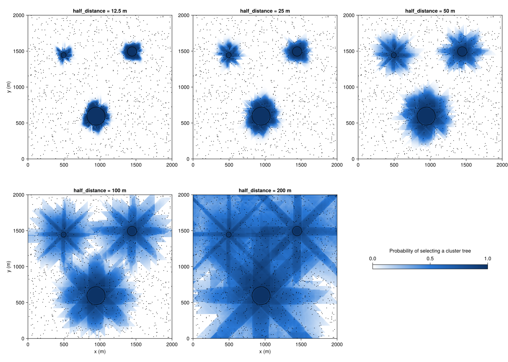
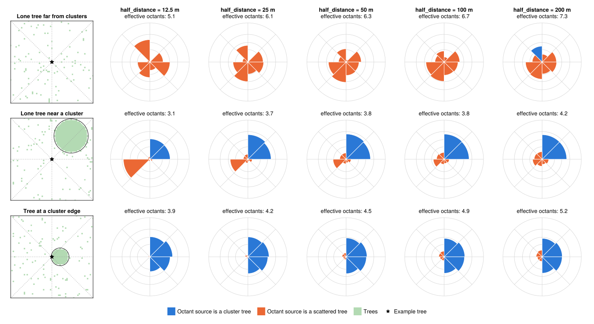
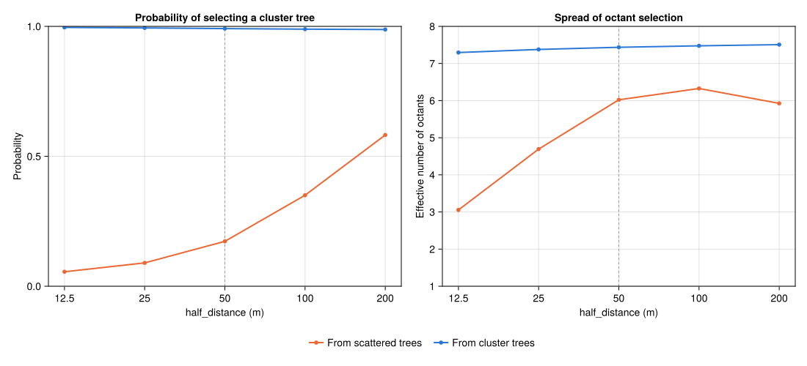

# Attraction half distance (octants)

> **Archived.** The octant attraction model examined here (`TreeAttractionOctants`, `BeetleMovementOctants`)
> was not adopted, and is no longer part of the model.
> The same question for radial attraction (`TreeAttraction`) is covered by the experiment *Attraction half distance*.

## Question

How does `half_distance` of the attraction kernel affect how strongly clusters of trees dominate over scattered trees,
with octant attraction?
How likely are beetles to select a cluster tree, and how spread out is their choice of direction?

## Setup

All parameters are set in [`run.jl`](https://github.com/pwn-model/PWNModel.jl/blob/main/explore/archive/attraction_half_distance_octants/run.jl).

- **Landscape**: 2 km × 2 km, 10 m cells.
  Three round, fully stocked clusters with radii of 30 m, 60 m and 120 m,
  and scattered trees in 2.5 % of all other cells, placed at random.
  All trees are healthy.
- **Attraction**: healthy-tree attraction with `density_radius` 20 m and `density_weight` 1.
  `half_distance` is varied: 12.5, 25, 50 (the default), 100 and 200 m.
  Damaged-tree attraction works the same way, so it is not shown separately.
- **Attraction model**: `TreeAttractionOctants` (octant attraction, used by `BeetleMovementOctants`).
  The archived code of both systems is in [`archive/octants`](https://github.com/pwn-model/PWNModel.jl/blob/main/explore/archive/octants).
  There are no beetles. Only the attraction is calculated, once.

With `density_weight` 1, each tree's attraction starts at its local occupancy:
the fraction of cells with a tree within `density_radius` (here, a square of 5 × 5 cells).
Inside a cluster, this is 1. For a lone scattered tree, it is 1/25.
Attraction halves every `half_distance` meters.
A cluster tree therefore stays more attractive than a lone tree up to `half_distance` × log₂ 25 ≈ 4.6 × `half_distance` farther away:
58 m at 12.5 m, 232 m at 50 m, and 929 m at 200 m.

**Terms used below**
- *Octants*: beetles select one of 8 directions (octants), with probabilities proportional to the attraction of the most attractive tree in each.
- *Effective number of octants*: how many directions a beetle's choice is effectively spread over.
  It is 1 if one octant is always selected, and 8 if all are equally likely.
  (Technically, the exponential of the entropy of the 8 selection probabilities.)

## Running

From the `PWNModel.jl/` directory:

```
julia --project=explore explore/archive/attraction_half_distance_octants/run.jl
```

Figures are written to `out/` as SVG (and PNG). They are not committed, but shown on the web page.

## Figures

### Probability of selecting a cluster tree

For each cell, the probability that a beetle there selects an octant whose most attractive tree belongs to a cluster.
Black circles are the clusters, dots are scattered trees.



### Spread of octant selection

For each cell, the effective number of octants.
Black circles are the clusters, dots are scattered trees.


### Example trees

Selection probabilities of the 8 octants for three example trees (rows) and each `half_distance` (columns).
The area of each wedge is proportional to the probability of selecting that octant.
Gray rings are at probabilities of 0.1, 0.25, 0.5 and 1.
Blue wedges point towards a cluster tree, orange wedges towards a scattered tree.
The left column shows the trees within 300 m of the example tree (star), with the octant boundaries dashed.

- *Lone tree far from clusters*: no other tree within 20 m, 565 m from the nearest cluster.
- *Lone tree near a cluster*: no other tree within 20 m, 100 m from the edge of the largest cluster.
- *Tree at a cluster edge*: the westernmost tree of the 60 m cluster.



### Summary

Mean probability of selecting a cluster tree (left) and mean effective number of octants (right),
starting from scattered trees and from cluster trees, over `half_distance`.
Trees within 200 m of the world's border are left out, as they lack trees in some directions.
The dashed line marks the default of 50 m.



## Observations

- Beetles on scattered trees select a cluster tree with a mean probability of
  0.06 at 12.5 m, 0.17 at 50 m and 0.58 at 200 m.
  Clusters do not take over in a sharp, all-or-nothing way as with radial attraction
  (see the experiment *Attraction half distance*):
  their pull fades out gradually, along the 8 directions.
- The maps of the probability of selecting a cluster tree show 8 darker stripes radiating out from each cluster:
  horizontal, vertical and diagonal.
  These come from the octant model itself, not from the plotting.
  The octants are fixed in the landscape, with their boundaries at 0°, 45°, 90° and so on, seen from each cell.
  Seen from a distance, a cluster usually lies entirely within one octant, so the cluster is the target of one of the 8 octants.
  From a cell on one of these lines through the cluster, an octant boundary cuts the cluster in two.
  Two octants then each have a cluster tree as their most attractive tree, and the cluster gets two of the 8 choices instead of one.
  The stripes are as wide as the cluster, however far they reach.
  For example, 400 m south of the largest cluster at `half_distance` 200 m,
  the probability of selecting a cluster tree is 0.54–0.65 within the stripe, and 0.32–0.41 just outside it.
  So beetles are more likely to head for a cluster when they are in one of these 8 directions from it,
  which may bias dispersal around clusters towards these directions.
  The effect grows with `half_distance`, as distant clusters then keep more of their attraction.
- At small `half_distance`, distance decides: beetles on scattered trees mostly select the nearest tree or two,
  with an effective number of 3 octants at 12.5 m.
  At 50 m and above, the effective number is around 6.
  It drops slightly again at 200 m, because the octants that contain a cluster then take a larger share.
- Near a cluster, the cluster's octants dominate already at 25 m (*Lone tree near a cluster*).
  At a cluster edge, beetles almost always select a tree of the cluster itself, with any `half_distance`.
  The cluster's octants take nearly all of the probability, even though the scattered trees outside get a small share at larger `half_distance`.
